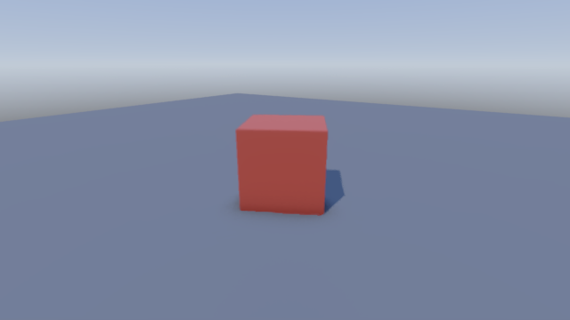

# Quick start: a cube on screen in five minutes

From a fresh machine to a red cube turning on a floor, with a camera you fly with WASD and
the mouse. Then where to go from there.

## 1. Install (once)

- **Windows 11 x64** with a current GPU driver: Vulkan 1.3, which every NVIDIA, AMD and
  Intel driver of the last years has.
- **Visual Studio Build Tools** with the C++ workload (MSVC and the Windows SDK). The
  engine compiles some C and C++ libraries (Jolt physics, FidelityFX, Opus).
- **[rustup](https://rustup.rs)**. The engine's pinned Rust version installs itself on the
  first build.
- **[NASM](https://nasm.us)** 2.14 or later on `PATH`: it assembles the software AV1
  decoder.
- **Git**, and the engine:

  ```text
  git clone https://github.com/VEGAMETA/ofeliaengine
  ```

## 2. Start a game

```text
cd ofeliaengine
cargo run --release -p engine_cli -- new ../mygame
```

`ofeliaengine new` makes a folder with a whole game in it:

| File | What it is |
|---|---|
| `src/main.rs` | the game's code: the cube turns, the camera follows your hand |
| `scenes/main.scene` | the scene: a floor, a cube, the sun, a camera ([scenes.md](scenes.md)) |
| `materials/` | the scene's materials: the floor's grey, the cube's red |
| `Cargo.toml` | the game's crate, depending on the engine's player (`engine_app`), with the editor behind its `editor` feature |
| `.cargo/config.toml`, `rust-toolchain.toml` | the engine's linker, instruction set and Rust version |
| `sounds/` | your sound files ([audio.md](audio.md)) |

## 3. Run it

```text
cd ../mygame
cargo run --release
```

- **The first build compiles the engine:** 74 s on the reference machine (Ryzen 7 7700).
- **After an edit,** your game rebuilds in about 2.5 s.



A red cube turns on a floor. Fly around it: **WASD** moves, the **mouse** looks.

## 4. Edit it

```text
cargo run --release --features editor
```

The same game in its editor (`ofeliaengine edit` runs this). It opens `scenes/main.scene`:

- **Click the cube** in the scene tree, then drag its numbers in the inspector: it moves
  as you drag, and Ctrl+Z takes it back.
- **Add** a light or another cube with **+** in the scene tree (or Ctrl+A).
- **Ctrl+S** saves the scene; `cargo run --release` plays what you saved.

The first build with the editor compiles it too. Its keys and tools:
[editor.md](editor.md).

## 5. The code

`src/main.rs` is the game's code, in four parts.

**The settings:** the window, the controls and the scene. Actions have names; keys are
bound to them ([input.md](input.md)).

```rust
let mut controls = InputMap::new();
let walk = controls.add_axis2d("move")?;
controls.bind(walk, Binding::wasd())?;
```

and `scene: Some("scenes/main.scene".into())` loads the scene into the world.

**The start:** once the scene is loaded, the game finds what it moves by name, the names
the editor's tree shows.

```rust
let cube = find_named(world, "Cube").ok_or("the scene has no `Cube`")?;
```

**The game:** two hooks the player calls ([player.md](player.md)).
- **`tick`** runs 64 times a second, the simulation; here the cube turns. Rendering
  interpolates between ticks, so motion is smooth at any frame rate.
- **`present`** runs every frame, after the ticks. What must follow the player's hand at
  once goes here; here the camera follows the mouse and the keys.

**`main`:** one line. It runs the player, or with the `editor` feature the editor around
the game:

```rust
engine_app::main!(settings, start);
```

Everything comes from one line: `use engine_app::prelude::*;`.

## 6. Change it

- **Its colour:** the first three numbers of `base_color` in `materials/paint.material`
  are red, green, blue.
- **Its speed:** `Quat::from_rotation_y(dt)` turns it a radian a second; double it.
- **More cubes:** select the cube in the editor and press Ctrl+D. The copies are
  "Cube 2", "Cube 3" and so on; only "Cube" turns, since the code finds it by name.
- **A lamp:** **+** → Point Light in the editor. In code, an entity with
  `PointLight::new(Vec3::new(1.0, 0.8, 0.6) * 10.0, 6.0)` and a `GlobalTransform` where it
  shines.

## 7. Models from Blender

Model in Blender (or anything that writes glTF), then cook it with the engine's command
line (in the engine's folder, `cargo run --release -p engine_cli --` stands for
`ofeliaengine`):

```text
ofeliaengine cook level.gltf -o level.pack
```

and give the pack to the player:

```rust
PlayerSettings { pack: Some("level.pack".into()), ..settings }
```

- **Its objects become entities** you can move and despawn.
- **Its meshes and textures** stream within the GPU's memory.
- **Its colliders and navigation mesh** are cooked in ([assets.md](assets.md),
  [physics.md](physics.md), [navigation.md](navigation.md)).

## 8. Next

| To | Read |
|---|---|
| edit scenes: the tree, the inspector, undo, the palette | [editor.md](editor.md) |
| scene files and materials | [scenes.md](scenes.md) |
| know what the player does for you | [player.md](player.md) |
| read the keyboard, mouse and gamepads | [input.md](input.md) |
| entities, components, queries | [ecs.md](ecs.md) |
| materials, lights, shadows, reflections | [rendering.md](rendering.md) |
| bodies that fall and collide | [physics.md](physics.md) |
| sound and music | [audio.md](audio.md) |
| saving and loading | [saves.md](saves.md) |
| playing together | [networking.md](networking.md) |
| text in many languages | [localization.md](localization.md) |
| where the frame's time goes | [profiling.md](profiling.md) |

All the guides: [README.md](README.md).
